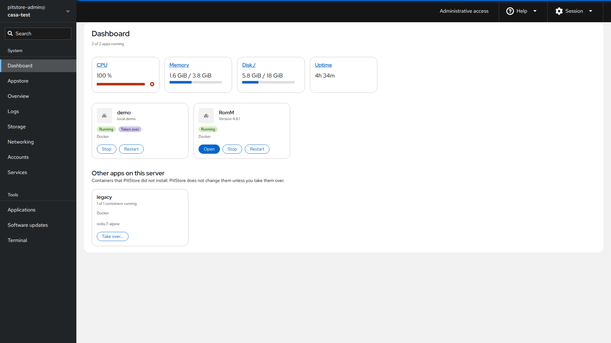
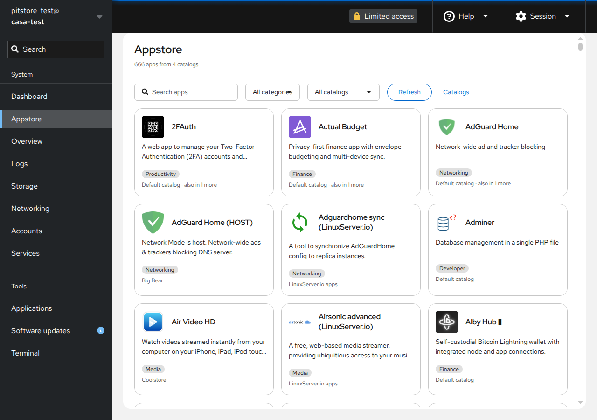

# PitStore

An app dashboard and app store for the [Cockpit](https://cockpit-project.org)
web console. PitStore adds two pages to Cockpit:

* **Dashboard**: tiles for your installed apps with their status, plus
  open, start, stop and restart buttons, a settings dialog to change or
  remove an app, and a compact system summary. Apps
  that PitStore did not install are listed too, and can be taken over after
  an analysis that shows what could go wrong and how to correct it.
* **Appstore**: browse, search and filter self-hosted apps from one or more
  catalogs in a single overview, read the details, and install, update or
  remove apps.

The catalog format is compatible with the
[CasaOS AppStore](https://github.com/IceWhaleTech/CasaOS-AppStore) (protocol
v2: Compose files with `x-casaos` metadata). PitStore is an independent
project and is not affiliated with or endorsed by IceWhale Technology.

Everything else (files, storage, users, networking, logs, metrics) is left to
Cockpit itself.

> Source code, releases and issues: <https://github.com/PeanutSkillz/pitstore>.

## Screenshots





## Requirements

* A Debian or Ubuntu based system with Cockpit 300 or newer (`cockpit-ws` and
  `cockpit-bridge`). The APT repository below serves a `.deb` for this family.
  Tested on Ubuntu 24.04 LTS (full test) and 22.04 LTS (install and remove):
  * Ubuntu 24.04: the version in the main archive (314) is fine.
  * Ubuntu 22.04: the main archive has 264, which is too old. Install Cockpit from
    `jammy-backports`: `sudo apt install -t jammy-backports cockpit`.
* Podman (recommended) or Docker to run apps.

**Other systemd-based distributions** (Fedora, RHEL, Arch, …) should work in
principle, since PitStore only needs Cockpit 300+, Python 3 and Podman or
Docker, but there is no package for them yet and they are not tested. You can
install from source with `make && sudo make install`. On systems with SELinux
enforcing, apps that use folders on the server do not work yet, because
PitStore does not relabel bind mounts.

## Installation (APT)

PitStore is distributed as a signed APT repository.

```sh
# 1. Add the repository signing key
sudo install -d -m 0755 /etc/apt/keyrings
curl -fsSL https://peanutskillz.github.io/pitstore/pitstore.asc \
  | sudo tee /etc/apt/keyrings/pitstore.asc > /dev/null

# 2. Add the repository
echo "deb [signed-by=/etc/apt/keyrings/pitstore.asc] https://peanutskillz.github.io/pitstore stable main" \
  | sudo tee /etc/apt/sources.list.d/pitstore.list

# 3. Install
sudo apt update
sudo apt install pitstore
```

Before you trust the key, check its fingerprint with
`gpg --show-keys /etc/apt/keyrings/pitstore.asc`. It must be

    83E5 1216 2375 2CF6 CBF7  F00F 6489 F3EF C0DF 9D6E

(also in the release notes and in `.github/pitstore.asc` of the repository).

Afterwards, log in to Cockpit (`https://<server>:9090`). **Dashboard** and
**Appstore** appear in the menu.

To remove PitStore: `sudo apt remove pitstore`. Removing the package does not
touch apps you installed with it, or their data.

## Security

* PitStore runs no daemon, opens no network port and has no login of its
  own. Everything goes through your Cockpit session.
* Privileged actions use Cockpit's administrative access ("superuser").
* Catalog Compose files are treated as untrusted. Dangerous options
  (`privileged`, host namespaces, extra capabilities, devices, mounts of
  the container runtime socket or system directories) are blocked unless you
  confirm them explicitly, per app.
* Taking over an existing app applies the same checks. PitStore never shows
  the values of its environment variables, and recreates containers only
  with the same images, folders and volumes, keeping the old ones until the
  new ones run.
* The Cockpit Content-Security-Policy is kept unchanged.

See [SECURITY.md](SECURITY.md) for how to report a vulnerability, and
[docs/threat-model.md](docs/threat-model.md) for the threat model.

## Development

Requirements: Node.js ≥ 20, npm, git, make. For the `.deb`: `debhelper` and
`lintian`.

```sh
make            # fetch the pinned Cockpit pkg/lib, npm ci, build into dist/
make check      # eslint, stylelint, typecheck, unit tests
make watch      # rebuild on change
make devel-install   # symlink dist/ into ~/.local/share/cockpit/pitstore
make deb        # production build, .deb in ../, lintian
```

With `make devel-install`, log in to a Cockpit on the same machine to see your
build. Use a test machine or VM, not a production server.

Architecture: [docs/architecture.md](docs/architecture.md).
Licensing: [docs/licensing.md](docs/licensing.md).
Contributing: [CONTRIBUTING.md](CONTRIBUTING.md).

## License

LGPL-2.1-or-later. See [LICENSE](LICENSE) and [docs/licensing.md](docs/licensing.md).
